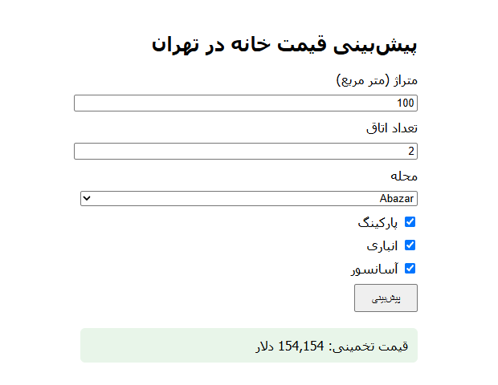

# Tehran House Price Prediction

A machine learning project that predicts apartment prices in Tehran (in USD) from basic property features: neighborhood, area, number of rooms, and amenities. It covers the full workflow: data cleaning, outlier removal, preprocessing, model comparison with hyperparameter tuning, evaluation, and a **Flask web app** where anyone can try the model in the browser.

## Live Demo

**Try it here: [amintnt2000.pythonanywhere.com](https://amintnt2000.pythonanywhere.com)**

## Web App

The trained model is served by a small Flask app. The user fills in a form (area, rooms, neighborhood, parking, warehouse, elevator) and gets an estimated price in USD.



Run it locally:

```bash
python app.py
```

Then open `http://127.0.0.1:5000`.

## Dataset

The dataset (`TehranHouse.csv`) contains about 3,450 listings with these columns:

| Column | Description |
|---|---|
| `Area` | Property size in square meters |
| `Room` | Number of rooms |
| `Parking` | Has parking (True/False) |
| `Warehouse` | Has storage room (True/False) |
| `Elevator` | Has elevator (True/False) |
| `Address` | Neighborhood name |
| `Price` | Price in Iranian Toman |
| `Price(USD)` | Price in US dollars (**target**) |

## Approach

1. **Missing values:** rows with a missing `Address` are dropped.
2. **Duplicates:** exact duplicate rows are removed.
3. **Dirty data:** `Area` was stored as text and contained invalid entries (for example, prices typed into the area column). It is converted to numeric and unparseable rows are removed.
4. **Outlier removal:**
   - Rows with less than 28 m² per room are removed as unrealistic.
   - Price per square meter (`price_per_m`) is computed **only for cleaning**. Within each neighborhood, rows more than `k` standard deviations from that neighborhood's mean are dropped (`k=2`). This is applied to the **training set only**, after the train/test split, so the test set stays realistic. `price_per_m` is *not* used as a model feature, since it is derived from the target and would cause data leakage.
5. **Rare neighborhoods:** neighborhoods with fewer than 5 training rows are grouped into `"other"`.
6. **Features and target:** features are `Address`, `Area`, `Room`, `Parking`, `Warehouse`, `Elevator`; the target is `Price(USD)`.
7. **Preprocessing:** one-hot encoding for `Address` (unknown neighborhoods are ignored), standard scaling for `Room`, `log1p` + standard scaling for `Area`, boolean columns passed through.
8. **Target transform:** the target is log-transformed (`log1p`) to handle the strongly skewed price distribution, and predictions are converted back with `expm1` (via `TransformedTargetRegressor`).
9. **Model selection:** four regressors are compared using `GridSearchCV` (5-fold cross-validation) inside a pipeline:
   - Support Vector Regression (SVR)
   - Random Forest
   - Ridge Regression
   - Decision Tree
10. **Evaluation:** the best configuration of each model is evaluated on a held-out 20% test set using R².
11. **Deployment:** the best model (SVR, linear kernel) is saved with `joblib`, loaded by the Flask app, and hosted on PythonAnywhere.

## Results

| Model | Best CV R² | Test R² | Best parameters |
|---|---|---|---|
| SVR | 0.889 | 0.751 | `C=1`, `kernel="linear"` |
| Random Forest | 0.843 | 0.696 | `n_estimators=200` |
| Ridge | 0.888 | 0.747 | `alpha=1` |
| Decision Tree | 0.796 | 0.582 | `criterion="absolute_error"`, `max_depth=20` |

**Key takeaways:**

- SVR and Ridge perform almost the same and clearly beat the tree-based models.
- The test R² is lower than the CV R² because outliers are removed only from the training data, while the test set keeps them, which is closer to real-world use.
- The neighborhood (`Address`) is the most important feature. Removing it dropped the Random Forest cross-validation R² noticeably in earlier experiments.

## Project Structure

```
tehran-house-price-prediction/
├── README.md
├── requirements.txt
├── app.py                    # Flask app
├── model.joblib              # saved full pipeline (SVR)
├── addresses.pkl             # neighborhood list for the dropdown
├── screenshots/
│   └── app.png               # app screenshot
├── templates/
│   └── index.html            # web form
├── data/
│   └── TehranHouse.csv
└── notebooks/
    └── tehran_housing_price.ipynb
```

## Getting Started

```bash
git clone https://github.com/amintnt2000/tehran-house-price-prediction.git
cd tehran-house-price-prediction

python -m venv venv
venv\Scripts\activate        # Windows
# source venv/bin/activate   # macOS / Linux

pip install -r requirements.txt
```

To retrain the model, run the notebook (`jupyter notebook notebooks/tehran_housing_price.ipynb`) and save the outputs with `joblib.dump`. To start the web app:

```bash
python app.py
```

The app was developed and deployed with Python 3.13 and these pinned versions (see `requirements.txt`):

```
flask==3.1.3
pandas==3.0.3
numpy==2.5.1
scikit-learn==1.9.0
joblib==1.6.0
```

> Use the same scikit-learn version for training and for running the app, otherwise loading `model.joblib` may fail or warn. To run the notebook you also need `jupyter`.

## Roadmap

- [x] Data cleaning and outlier removal
- [x] Model comparison with hyperparameter tuning
- [x] Re-run and record final results without data leakage
- [x] Save the full pipeline with `joblib`
- [x] Build a Flask web app where users enter neighborhood, area, rooms, and amenities and get a price estimate
- [x] Deploy the app on PythonAnywhere and add a live demo link and screenshot
- [ ] Improve the UI (e.g. Bootstrap) and keep the entered values after prediction

## Limitations

- The dataset is a snapshot of listings, not official sale prices, so predictions are estimates.
- Neighborhoods that do not appear in the training data cannot be predicted well.
- Features such as building age, floor, and exact location are not available in the data.

## AI Assistance

I built the data analysis, model training, and evaluation myself. I used Claude (Anthropic) as an assistant for the HTML template (`templates/index.html`) and for guidance on deploying the app to PythonAnywhere.

## Author

**Mohammad Amin Nochiyan**
GitHub: [@amintnt2000](https://github.com/amintnt2000)  
LinkedIn: [Mohammad Amin Nochiyan](https://www.linkedin.com/in/YOUR-LINKEDIN-ID)
